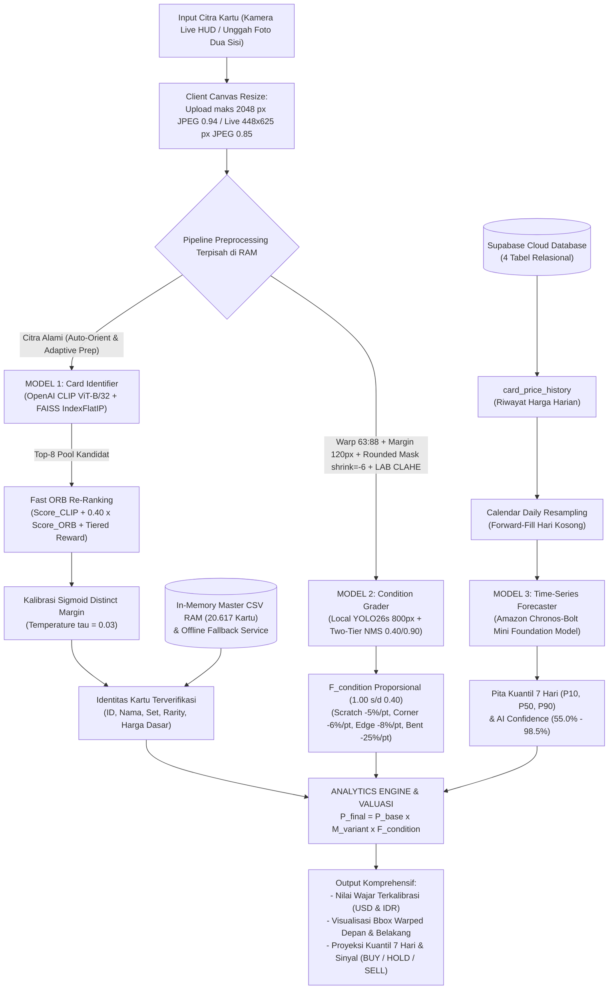

# Pokemon Card Value Analytic Tool | REGOKEMON

> **Platform Cerdas Identifikasi Kartu, Deteksi Cacat Fisik, dan Valuasi Harga Pasar Kartu Koleksi Pokémon TCG**

[](https://www.python.org/)
[](https://pytorch.org/)
[](https://github.com/mlfoundations/open_clip)
[](https://github.com/facebookresearch/faiss)
[](https://github.com/ultralytics/ultralytics)
[](https://github.com/amazon-science/chronos-forecasting)
[](https://supabase.com/)
[](https://fastapi.tiangolo.com/)
[](https://react.dev/)
[](https://hub.docker.com/r/bejochan/regokemon-backend)
[](https://github.com/features/actions)
[](https://pokemontcg.io/)

---

## Ringkasan Proyek

**Pokemon Card Value Analytic Tool (REGOKEMON)** adalah sistem analitika data dan kecerdasan buatan berbasis **Triple-Engine AI & Prescriptive Analytics** untuk identifikasi kartu koleksi, inspeksi kondisi fisik dua sisi, dan valuasi harga pasar sekunder (seperti Tokopedia, Shopee, eBay, maupun TCGPlayer).

Sistem ini memecahkan empat tantangan utama ekosistem kartu koleksi (TCG):
1. **Identifikasi Kartu Skala Masif (Model 1):** Mengenali varian kartu secara *zero-shot* di antara **20.617 kartu resmi** (172 set ekspansi) menggunakan representasi semantik **OpenAI CLIP (`ViT-B/32`)**, pencarian vektor **FAISS (`IndexFlatIP`)**, dan verifikasi fitur lokal **Fast ORB** untuk membedakan kartu cetak ulang (*reprint*).
2. **Inspeksi Cacat Fisik Dua Sisi (Model 2):** Mendeteksi serta melokalisasi cacat permukaan (`Corner Wear`, `Edge Wear`, `Scratch`, dan batas `Card`) pada tampak depan dan belakang kartu menggunakan **YOLO26s (`800px`)** dengan *pipeline preprocessing* di RAM (*perspective warp* 63:88 + margin 120 px, *rounded-card silhouette masking* 3,2 mm `shrink=-6`, normalisasi *veiling glare*, *adaptive unsharp masking*, *LAB CLAHE*, dan *Two-Tier NMS*), serta mengirim `front_warped_image` / `back_warped_image` ke antarmuka agar *bounding box* sejajar presisi.
3. **Peramalan Deret Waktu & Sinyal Preskriptif (Model 3):** Memproyeksikan tren harga 7 hari ke depan dalam bentuk pita kuantil probabilistik (`P10`, `P50`, `P90`) serta menghasilkan sinyal rekomendasi transaksi (`BUY`, `HOLD`, `SELL`) menggunakan *foundation model* **Amazon Chronos-Bolt Mini**.
4. **Valuasi Harga Wajar Dinamis:** Menggabungkan harga pasar konsolidasi (TCGPlayer & Cardmarket via Supabase Cloud atau *fallback* CSV lokal `offline_service.py`), faktor vintage (`< 2005`), dan potongan kondisi fisik objektif ke dalam nilai wajar USD dan IDR secara langsung.

---

## Anggota Kelompok (Kelas D4 Sains Data Terapan B - 2024)

| No | Nama Mahasiswa | NRP | Akun GitHub | Peran Utama dalam Proyek |
| :---: | :--- | :---: | :---: | :--- |
| 1 | **Adnan Oktar** | `3324600039` | `Bejochan` | Arsitektur Backend FastAPI, Model 1 (`CLIP + FAISS + ORB`), Docker & CI/CD |
| 2 | **Tegar Maulana Kusuma** | `3324600053` | `tegarkusuma12` | Model 2 (`YOLO26s` Condition Grader), EDA Dataset Roboflow v5, Halaman Marketplace |
| 3 | **Udi Adhahaska Arta Ananta** | `3324600052` | `Kyouji Prinz` | Analitika Dashboard 6 Modul, Offline CSV Fallback Service, Kurs Live & UI Scanner |
| 4 | **Faruq Iqbal Suhail** | `3324600049` | `GumdropAngel` | Desain Antarmuka Frontend (Modal Detail Catalog, Marketplace, Tata Letak Visual) |

---

## Tautan Deliverable Proyek

| Komponen Deliverable | Tautan Publik | Keterangan |
| :--- | :--- | :--- |
| **Repositori GitHub** | `https://github.com/Bejochan/pokemon-card-value-analytic-tool` | Kode sumber lengkap (`frontend/`, `backend/`, `backend/notebooks/`, `docs/`, Docker & CI) |
| **Aplikasi Web (Vercel)** | `https://pokemon-card-value-analytic-tool.vercel.app` | Frontend SPA React 19 + Vite (*backend* AI dijalankan lokal via Docker Compose / Uvicorn) |
| **Docker Hub Backend** | `https://hub.docker.com/r/bejochan/regokemon-backend` | Image siap pakai (`bejochan/regokemon-backend:latest`, port `8000`) termasuk bobot AI & dataset CSV |
| **Docker Hub Frontend** | `https://hub.docker.com/r/bejochan/regokemon-frontend` | Image Nginx Alpine SPA (`bejochan/regokemon-frontend:latest`, port `5173`) |
| **Video Demonstrasi (5-10 Menit)** | `[MASUKKAN LINK YOUTUBE UNLISTED / GOOGLE DRIVE PUBLIK]` | Rekaman demo aplikasi berjalan, alur input-output, dan ringkasan evaluasi model |
| **Dokumentasi Interaktif API** | `http://127.0.0.1:8000/docs` | Swagger UI otomatis saat layanan backend berjalan |

---

## Arsitektur Triple-Engine AI & Analytics



---

### 1. Model 1: Card Identification Engine (`CLIP ViT-B/32 + FAISS + ORB`)

* **Backbone:** *Vision Transformer* **`openai/clip-vit-base-patch32`** (`ViT-B/32`, masukan `224x224` px, 49 patch `32x32` px, 12 blok *transformer*) yang dibekukan (*frozen*) untuk mengekstrak vektor *embedding* berdimensi 512 yang dinormalisasi L2.
* **Mengapa Vision Transformer (ViT), Bukan CNN Konvensional?**
  * **Global Self-Attention:** Memproses korelasi seluruh petak kartu secara simultan (nama kartu di atas, ilustrasi tengah, dan nomor seri di bawah).
  * **Open-Set Metric Learning:** Tidak memakai lapisan *Softmax* tertutup, sehingga penambahan set/kartu baru cukup dengan menambahkan vektor 512-D ke indeks FAISS tanpa melatih ulang model.
  * **Ketahanan Optik:** Tahan terhadap pantulan pelindung plastik (*sleeve glare*) maupun sudut miring ringan.
* **Vector Indexing (`FAISS IndexFlatIP`):** Seluruh 20.617 citra katalog resmi disimpan sebagai indeks vektor 512-*float32* (`card_embeddings.index`, ~40,3 MB di disk), sehingga pencarian *Cosine Similarity* berjalan sub-milidetik.
* **Two-Stage Re-Ranking (`Fast ORB`):** Untuk membedakan varian kartu cetak ulang (*reprint*) yang ilustrasinya identik, sistem mengekstrak hingga 500 *keypoints* ORB pada pool kandidat (`Top-8` pada API produksi [`cv_service.py`](backend/app/cv_service.py), serta `Top-4` pada skrip desktop [`card_identifier_realtime.py`](backend/models/card_identifier_realtime.py)):
  ```text
  Score_blended = Score_CLIP + (0.40 * Score_ORB)
  ```
  Kandidat di luar 8 besar pada evaluasi penuh tetap dapat memperoleh *tiered verification reward* (`0.70` jika `Score_ORB >= 0.08` atau `0.50` jika `Score_ORB >= 0.05`) bila kecocokan geometri lokalnya tinggi.
* **Kalibrasi Keyakinan Sigmoid:** Menghitung selisih skor ke kandidat teratas dengan **nama kartu berbeda** (`distinct_margin`) agar varian *reprint* bernilai mirip tidak menurunkan keyakinan, lalu diskalakan dengan temperatur `tau = 0.03`:
  ```text
  Confidence (%) = 100 / (1 + exp(-distinct_margin / 0.03))
  ```
* **Optimasi Klien & Mode Offline:**
  * **Live Scanner HUD Web:** Memotong kotak panduan proporsi `63:88` ke *canvas* `448 x 625 px` (JPEG `0.85`), memeriksa skor ketajaman multi-zona (`>= 14`), polling tiap `400 ms`, dan mengunci hasil memakai **ring buffer konsensus 3 frame** (ambang keyakinan `>= 48%`, minimal 2/3 frame cocok).
  * **Upload Foto Statis:** Mereskalasi sisi terpanjang hingga maksimal `2048 px` (JPEG `0.94`) untuk mempertahankan ketajaman goresan tipis dan teks nomor seri.
  * **Background Pre-Warming & Offline Isolation:** Memanaskan bobot CLIP, YOLO, dan Chronos-Bolt di thread latar belakang saat FastAPI booting, mengunci `HF_HUB_OFFLINE=1` & `TRANSFORMERS_OFFLINE=1`, dan fallback otomatis ke master CSV di RAM ([`offline_service.py`](backend/app/offline_service.py)).
* **Varian CLI Desktop Model 1:**
  1. [`backend/models/card_identifier_realtime.py`](backend/models/card_identifier_realtime.py): HUD kamera asinkron (*multithreaded worker*).
  2. [`backend/models/card_identifier_oncam.py`](backend/models/card_identifier_oncam.py): Pemindai *snapshot* kamera interaktif.
  3. [`backend/models/card_identifier_manual.py`](backend/models/card_identifier_manual.py): Evaluasi berkas foto statis dengan 4-arah orientasi otomatis.
* **Dokumentasi Rinci:** [`docs/clip_model_architecture_and_rationale.md`](docs/clip_model_architecture_and_rationale.md)

---

### 2. Model 2: Card Condition Grader (`YOLO26s 800px` & Inspeksi Dua Sisi)

* **Arsitektur & Bobot Model:**
  * **Model Utama (`models/best-model-v6-card-condition.pt`, ~19,4 MB):** **Ultralytics YOLO26s** beresolusi native `800 x 800` px (`imgsz=800`, `box=7.5`, `cls=1.2`), mencapai **`mAP@50 = 0.4277`** pada *test split* independen 71 citra (`Card`: `0.995`, `Corner Wear`: `0.602`, `Edge Wear`: `0.087`, `Scratch`: `0.027`).
  * **Fallback Otomatis:** Memuat `models/best-model-v5-card-condition.pt` (`YOLO11s`, ~16,8 MB) apabila bobot V6 tidak tersedia, atau memanfaatkan Roboflow Cloud Inference API apabila `ROBOFLOW_API_KEY` dikonfigurasi.
* **Pipeline Preprocessing Terisolasi di RAM ([`card_condition.py`](backend/models/card_condition.py)):**
  Dijalankan dengan batas resolusi server `resize_image_if_oversized` (`2048 px`):
  1. **Deteksi Kontur & Perspective Warp:** Meluruskan bidang kartu ke ukuran standar `600 x 837 px` (rasio `63:88`) ditambah **margin luar `120 px`** berwarna gelap netral `(20, 20, 22)`. Citra hasil warp (`front_warped_image` & `back_warped_image`) turut dikirim ke frontend agar *bounding box* cacat tampil sejajar presisi.
  2. **Rounded-Card Silhouette Masking (`3,2 mm`, `shrink=-6`):** Menerapkan *mask* sudut lengkung kartu Pokémon (~`30,5 px` pada lebar `600 px`) dengan pelonggaran `6 px` pada latar terang agar segitiga meja putih di pojok tidak terdeteksi palsu sebagai `Corner Wear` tanpa memangkas tepi kartu.
  3. **Veiling Glare Normalization:** Peregangan kontras persentil ke-2 dan ke-99,5 pada kanal pencahayaan citra berlatar terang.
  4. **Adaptive Unsharp Masking & LAB CLAHE:** Penajaman kondisional bila variansi Laplacian `< 70.0`, diikuti `CLAHE` (`clipLimit=2.5`, `tileGridSize=8x8`).
  5. **Two-Tier NMS & Safe Device Fallback:** NMS per kelas (`iou_threshold=0.40`), deduplikasi lintas kelas untuk kotak hampir identik (`cross_class_iou=0.90`), serta fallback otomatis ke `device="cpu"` bila backend CUDA perangkat belum memiliki kernel `torchvision::nms`.
* **Aturan Depresiasi Kondisi Fisik Proporsional ([`analytics_engine.py`](backend/app/analytics_engine.py)):**
  Dari akumulasi cacat tampak depan dan tampak belakang kartu (`detect_card_defects_dual_side`), fungsi `calculate_condition_factor` menghitung pengali `F_condition` antara `1.00` hingga batas bawah `0.40`:
  * **Tanpa cacat (`Near Mint / Mint`):** `F_condition = 1.00` (diskon 0%)
  * **`Scratch`:** diskon **5% per titik** (maksimum **20%**)
  * **`Corner Wear`:** diskon **6% per sudut** (maksimum **24%**)
  * **`Edge Wear`:** diskon **8% per sisi** (maksimum **25%**)
  * **`Bent / Crease`:** diskon struktural **25% per titik** (maksimum **40%**)
  * **Akumulasi seluruh cacat:** total potongan dibatasi maksimal **60%** (lantai `F_condition = 0.40`; tier: `>= 0.95` *Near Mint/Mint*, `>= 0.80` *Lightly Played*, `>= 0.65` *Moderately Played*, `>= 0.50` *Heavily Played*, `< 0.50` *Damaged*). Jika total diskon cacat fisik `>= 30%`, sinyal transaksi otomatis ditahan pada **`HOLD`**.
* **Dokumentasi Rinci:** [`docs/yolo_model_architecture_and_rationale.md`](docs/yolo_model_architecture_and_rationale.md)

---

### 3. Model 3: Time-Series Forecaster (`Amazon Chronos-Bolt Mini`)

* **Backbone:** *Pre-trained Time-Series Foundation Model* **`amazon/chronos-bolt-mini`** berbasis arsitektur T5 Encoder-Decoder secara *zero-shot* (memerlukan minimal 5 titik riwayat harga harian).
* **Resampling Kalender Harian:** Menyelaraskan deret harga historis dari tabel Supabase `card_price_history` ke frekuensi kalender harian (`D`) memakai *forward-fill* (`ffill`) untuk hari tanpa transaksi.
* **Proyeksi Multi-Kuantil & Sinyal Preskriptif ([`analytics_engine.py`](backend/app/analytics_engine.py)):**
  * Menghasilkan pita proyeksi 7 hari: `P10` (batas bawah pesimis), `P50` (median harga wajar), dan `P90` (batas atas optimis).
  * Menghitung **AI Confidence Dinamis** berdasarkan rasio sebaran pita hari ke-1 `Spread Ratio = (P90 - P10) / max(P50, 0.01)`:
    ```text
    AI Confidence (%) = clamp(100.0 - (Spread Ratio * 25.0), min=55.0, max=98.5)
    ```
  * Membandingkan nilai wajar kartu terkalibrasi kondisi terhadap lorong kuantil hari ke-1 terkalibrasi: `BUY` (`< P10`), `HOLD` (`P10 <= nilai <= P90` atau diskon cacat `>= 30%`), `SELL` (`> P90`).
  * Jika riwayat `< 5` hari, sistem melakukan *graceful fallback* ke nilai pasar acuan / model regresi tabular `RandomForestRegressor` agar API tetap mengembalikan `HTTP 200 OK`.
* **Dokumentasi Rinci:** [`docs/chronos_model_architecture_and_rationale.md`](docs/chronos_model_architecture_and_rationale.md)

---

### 4. Formula Valuasi Harga Wajar

```text
P_final = P_base * M_variant * F_condition
```

* **`P_base`:** Harga acuan pasar konsolidasi TCGPlayer & Cardmarket (diambil dari master RAM / Supabase `card_prices`).
* **`M_variant`:** Faktor apresiasi edisi *vintage* sebesar **`1.20`** (`+20%`) bagi kartu dengan tahun rilis `< 2005`, dan `1.00` untuk kartu modern.
* **`F_condition`:** Pengali kondisi fisik proporsional dari Model 2 (`0.40` s/d `1.00`).

---

## Tolak Ukur Kuantitatif & Benchmark Komputasi

| Parameter Evaluasi | Nilai Benchmark Terukur | Catatan Sumber Pengujian |
| :--- | :---: | :--- |
| **Akurasi Identifikasi Kamera (`N = 17` `val_samples`)** | **88,2% Top-1 / 100,0% Top-5** | Mode standar (`calibrate_confidence.py`, pool=8, `tau=0.03`) |
| **Akurasi Mode Live Konsensus (`N = 17`, `fast_mode`)** | **82,4% Top-1 / 88,2% Top-5** | Rata-rata latensi stream konsensus **`~219,7 ms`** (`benchmark_realtime_results.json`) |
| **Uji 4 Skenario Optik Model 1 (`N = 17`, CPU)** | **100% Standar & Reprint** | `88,2%` miring 15 deg, `94,1%` glare; rata-rata latensi CPU `98,4 ms` (`model_comparison_card_identifier.ipynb`) |
| **Deteksi Cacat Fisik `YOLO26s` (Test Split 71 Citra)** | **`mAP@50 = 0,4277`** | `P = 0,4755`, `R = 0,4669`, `mAP@50-95 = 0,3173` (`Card`: `0,995`; `Corner Wear`: `0,602`) |
| **Waktu Respons End-to-End `POST /identify`** | **300,8 ms (GPU) / 469,1 ms (Docker CPU)** | Pengujian 3x pasca-warmup pada Intel Core i7-12650H + RTX 2050 |
| **Waktu Respons End-to-End `POST /analyze`** | **~1,37 s (GPU) / ~1,52 s (Docker CPU)** | Identifikasi + deteksi cacat 2 sisi + valuasi (`1,08 s` mode fallback CSV Docker) |
| **Waktu Respons `GET /cards/.../forecast`** | **658,2 ms (GPU) / 237,6 ms (Docker)** | Termasuk kueri riwayat; `11 ms` pada mode fallback lokal DevTools |
| **Ukuran Payload & Dimensi Vektor** | **2048 px Upload / 448x625 Live \| 512-D FAISS** | `IndexFlatIP` untuk 20.617 kartu (~40,3 MB di disk) |
| **Cakupan Dataset Katalog & Sinkronisasi** | **20.617 Kartu / 172 Set** | `19.686` kartu (`95,48%`) harga aktif; cron harian GitHub Actions |

---

## Dataset & Database Cloud Supabase

| Entitas Data | Volume | Keterangan |
| :--- | :---: | :--- |
| **Katalog Kartu Bersih** | **20.617 baris** | Tersedia lokal di `backend/dataset/pokemon_cards_dataset_cleaned.csv` |
| **Ekspansi Rilis (`sets`)** | **172 Set** | *Base Set* (1999) hingga ekspansi terbaru |
| **Dataset Deteksi Cacat** | **1.495 citra bersih (11.358 bbox)** | Roboflow `card-grader` v5 (`1.302 train`, `122 valid`, `71 test`) |
| **Tabel Relasional PostgreSQL** | **4 Tabel** | `sets`, `cards`, `card_prices`, `card_price_history` ([`docs/schema.sql`](docs/schema.sql)) |
| **Cakupan Harga Efektif** | **95,48% (19.686 kartu)** | Sinkronisasi harian otomatis melalui `.github/workflows/daily_price_cron.yml` |

> **Dokumentasi Teknis Lengkap:**
> * [`docs/clip_model_architecture_and_rationale.md`](docs/clip_model_architecture_and_rationale.md) : Arsitektur & rasional Model 1 (`CLIP ViT-B/32 + FAISS + ORB`)
> * [`docs/yolo_model_architecture_and_rationale.md`](docs/yolo_model_architecture_and_rationale.md) : Arsitektur & rasional Model 2 (`YOLO26s 800px`)
> * [`docs/chronos_model_architecture_and_rationale.md`](docs/chronos_model_architecture_and_rationale.md) : Arsitektur & rasional Model 3 (`Amazon Chronos-Bolt Mini`)
> * [`docs/api_specification.md`](docs/api_specification.md) : Spesifikasi 14 REST API endpoint beserta contoh request/response
> * [`docs/docker_architecture_and_deployment.md`](docs/docker_architecture_and_deployment.md) : Arsitektur container multi-service, *offline cache*, & Docker Hub
> * [`docs/dataset_dictionary.md`](docs/dataset_dictionary.md) : Kamus 22 variabel dataset CSV
> * [`docs/dataset_summary_and_metrics.md`](docs/dataset_summary_and_metrics.md) : Ringkasan statistik & daftar skrip pipeline data
> * [`docs/supabase_database_dictionary.md`](docs/supabase_database_dictionary.md) : ERD Mermaid & kamus atribut 4 tabel database
> * [`docs/schema.sql`](docs/schema.sql) : Skrip DDL pembuatan tabel & indeks database PostgreSQL

---

## Struktur Repositori

```text
pokemon-card-value-analytic-tool/
├── .github/
│   └── workflows/
│       ├── backend_ci.yml                      # CI pengujian kompilasi Python, keamanan API, & endpoint
│       ├── daily_price_cron.yml                # Cron job harian sinkronisasi harga ke Supabase
│       └── sync_fork.yml                       # Sinkronisasi cabang khusus repositori fork
│
├── backend/                                    # Backend Python, FastAPI, AI Engines, & Notebooks
│   ├── Dockerfile                              # Container build FastAPI + PyTorch CPU + offline HuggingFace cache
│   ├── .dockerignore                           # Pengecualian kredensial & dataset mentah dari Docker build
│   ├── .env.example                            # Template variabel lingkungan (tanpa kredensial)
│   ├── requirements.txt                        # Daftar lengkap dependensi Python backend
│   ├── app/                                    # Modul REST API FastAPI
│   │   ├── main.py                             # Entrypoint server (14 endpoint, CORS, 15MB limit, rate limiter)
│   │   ├── cv_service.py                       # Bridge Model 1 (CLIP+FAISS+ORB) & Model 2 (YOLO26s dual-side)
│   │   ├── analytics_engine.py                 # Valuasi P_final, depresiasi F_condition, & Chronos Forecaster
│   │   ├── offline_service.py                  # Offline CSV Fallback untuk katalog, set, histori, & dashboard
│   │   ├── currency_service.py                 # Kurs USD ke IDR live dengan cache & fallback rate
│   │   └── schemas.py                          # Skema validasi Pydantic
│   │
│   ├── dataset/                                # Dataset master & sampel validasi
│   │   ├── pokemon_cards_dataset_cleaned.csv   # Dataset bersih 20.617 kartu (dipakai API & seed)
│   │   ├── pokemon_cards_dataset_cleaned.json  # Versi JSON dataset bersih
│   │   ├── broken_links_report.csv             # Laporan audit 53 tautan CDN rusak
│   │   ├── card_condition_dataset.yaml         # Konfigurasi kelas YOLO (4 kelas, Roboflow v5)
│   │   ├── val_samples/                        # 17 foto kamera kartu riil untuk uji validasi lokal
│   │   └── compressed_images/                  # [Git-ignored] 20.617 JPG 640x640 (dihasilkan via download + compress)
│   │
│   ├── models/                                 # Engine AI & utilitas indeks
│   │   ├── best-model-v6-card-condition.pt     # [Git-ignored, ada di Docker Hub] Bobot utama YOLO26s 800px (~19.4 MB)
│   │   ├── best-model-v5-card-condition.pt     # [Git-ignored, ada di Docker Hub] Bobot fallback YOLO11s (~16.8 MB)
│   │   ├── card_embeddings.index               # [Git-ignored, ada di Docker Hub] Binary indeks FAISS (~40.3 MB)
│   │   ├── card_id_map.json                    # Pemetaan indeks FAISS ke 20.617 card_id resmi
│   │   ├── card_identifier.py                  # Engine Model 1 (CLIP + FAISS + ORB + kalibrasi sigmoid)
│   │   ├── card_identifier_realtime.py         # Demo desktop Live Scanner HUD (OpenCV multithreaded)
│   │   ├── card_identifier_oncam.py            # Pemindai snapshot kamera
│   │   ├── card_identifier_manual.py           # Pengujian foto statis via GUI / CLI
│   │   ├── card_condition.py                   # Engine Model 2 (perspective warp, rounded mask, CLAHE, Two-Tier NMS)
│   │   ├── card_condition_grader.py            # Fallback Roboflow Cloud Inference API
│   │   ├── chronos_forecaster.py               # Engine Model 3 (Amazon Chronos-Bolt Mini 7 hari)
│   │   ├── build_card_index.py                 # Pembangun ulang file indeks FAISS dari compressed_images
│   │   ├── calibrate_confidence.py             # Pencarian temperatur kalibrasi optimal pada val_samples
│   │   ├── live_card_condition_test.py         # Pengujian deteksi cacat secara langsung via kamera
│   │   └── legacy_mobilenet/                   # Arsip baseline MobileNetV3 untuk komparasi model
│   │
│   ├── notebooks/                              # Eksperimen & Evaluasi (13 Jupyter Notebooks)
│   │   ├── analitik_harga_kartu_pokemon.ipynb      # Analisis pergerakan harga & distribusi kelangkaan
│   │   ├── eda_card_condition_v5.ipynb             # EDA dataset Roboflow Card Condition v5
│   │   ├── eda_condition_card_roboflow.ipynb       # Eksplorasi awal dataset Roboflow Card Grader
│   │   ├── eda_heatmap.ipynb                       # Korelasi fitur dan matriks panas data pasar
│   │   ├── eda_pokemon_images.ipynb                # Inspeksi dimensi, rasio, dan kualitas gambar kartu
│   │   ├── eda_pokemon_json.ipynb                  # Ekstraksi dan pemetaan struktur JSON pokemontcg.io
│   │   ├── eda_research_tcg.ipynb                  # Visualisasi distribusi data & pemodelan awal
│   │   ├── forecasting_model.ipynb                 # Eksperimen peramalan deret waktu & regresi tabular
│   │   ├── model_comparison_card_identifier.ipynb  # Komparasi akurasi MobileNetV3 vs CLIP ViT-B-32
│   │   ├── modeling_card_condition.ipynb           # Pelatihan dan evaluasi komparasi YOLO V3, V5, & V6.1
│   │   ├── test_card_condition_grader.ipynb        # Pengujian deteksi cacat Roboflow fallback
│   │   ├── test_card_condition_retrain.ipynb       # Pelatihan ulang dan evaluasi mAP model YOLO
│   │   └── valuation_analytics.ipynb               # Analisis mendalam formula valuasi & pasar
│   │
│   ├── fetch_pokemon_data.py                   # Pengambil katalog mentah dari pokemontcg.io v2 API
│   ├── check_broken_links.py                   # Pengecek status HTTP tautan gambar katalog
│   ├── clean_csv_broken_links.py               # Pembersih entri CSV dengan tautan rusak
│   ├── export_broken_links.py                  # Eksportir daftar 53 kartu broken link ke CSV
│   ├── pokemon_cards_dataset_download.py       # Pengunduh paralel citra kartu dari CSV bersih
│   ├── compress_images.py                      # Konversi & resize citra ke JPG 640x640 Lanczos
│   ├── json_to_csv.py                          # Sinkronisasi JSON dengan aset gambar lokal ke CSV
│   ├── card_condition_dataset_download.py      # Pengunduh dataset cacat fisik Roboflow v5
│   ├── seed_supabase.py                        # Skrip seeding tabel sets, cards, & card_prices ke Supabase
│   ├── daily_price_tracker.py                  # Sinkronisasi harian harga & riwayat ke Supabase
│   ├── benchmark_realtime_results.json         # Hasil benchmark latensi & akurasi mode live 17 sampel
│   ├── test_api_endpoints.py                   # Uji integrasi endpoint /forecast dan /condition
│   ├── test_security_hardening.py              # Uji CORS whitelist, batas payload 15 MB, & rate limiter
│   └── test_realtime_simulation.py             # Simulasi evaluasi pemindaian stream
│
├── frontend/                                   # Single Page Application (React 19 + Vite)
│   ├── Dockerfile                              # Multi-stage build (Node 22 Alpine -> Nginx Alpine)
│   ├── nginx.conf                              # Konfigurasi Nginx gzip & SPA fallback
│   ├── .dockerignore                           # Pengecualian node_modules, dist, & .env lokal
│   ├── .env.example                            # Template VITE_API_BASE_URL
│   ├── README.md                               # Dokumentasi ringkas komponen frontend
│   ├── public/                                 # Aset statis web termasuk pokemon-card-back.png (63:88)
│   ├── package.json                            # Dependensi Node.js (React 19.2, Vite 8.2)
│   ├── vercel.json                             # Konfigurasi rewrite SPA Vercel
│   └── src/
│       ├── components/
│       │   ├── UploadPage.jsx                  # Live HUD (448x625) & Upload Inspeksi Dua Sisi (2048px)
│       │   ├── ScannerDashboard.jsx            # Detail valuasi, bbox warped image, grafik Chronos P10-P90
│       │   ├── CatalogPage.jsx                 # Katalog 20.617 kartu (filter set, search, kurs IDR)
│       │   ├── HoloCard3D.jsx                  # Kartu 3D holografik interaktif (spring lerp, flip 360°, focus mode)
│       │   ├── DashboardPage.jsx               # Dashboard analitika pasar dinamis 6 modul
│       │   ├── Marketplace.jsx                 # Simulasi marketplace sekunder & keranjang
│       │   ├── HeroSection.jsx                 # Halaman beranda
│       │   └── Navbar.jsx                      # Navigasi global SPA
│       ├── config/api.js                       # Pembaca VITE_API_BASE_URL
│       ├── App.jsx
│       └── main.jsx
│
├── docs/                                       # Dokumentasi teknis arsitektur, API, Docker, & SQL
├── docker-compose.yml                          # Orkestrasi full-stack (backend :8000 & frontend :5173)
├── vercel.json                                 # Konfigurasi deployment root Vercel
└── README.md
```

---

## Panduan Instalasi & Menjalankan Sistem

### Opsi 1 (Disarankan - Langsung Jalan via Docker Hub)

Cara tercepat menjalankan seluruh layanan (**Backend FastAPI + 3 Model AI + Frontend React**) secara lokal tanpa menginstal Python, PyTorch, CUDA, ataupun Node.js, karena bobot model `.pt`, indeks FAISS, *cache* `CLIP` & `Chronos-Bolt`, serta dataset CSV fallback sudah dibundel di dalam image Docker Hub.

**Prasyarat:** Docker Desktop berstatus *Running*, port `8000` dan `5173` kosong, serta koneksi internet saat penarikan image pertama kali.

```powershell
# 1. Clone repositori
git clone https://github.com/Bejochan/pokemon-card-value-analytic-tool.git
cd pokemon-card-value-analytic-tool

# 2. Tarik image siap pakai dari Docker Hub lalu jalankan container
docker compose pull
docker compose up -d

# 3. Pantau kesiapan healthcheck (tunggu hingga regokemon-backend berstatus healthy)
docker compose ps
```

Akses aplikasi setelah container sehat:
* **Web Portal (Frontend):** `http://localhost:5173`
* **Dokumentasi Interaktif REST API (Swagger UI):** `http://127.0.0.1:8000/docs`
* **Endpoint Healthcheck JSON:** `http://127.0.0.1:8000/health`

Untuk menghentikan layanan:
```powershell
docker compose down
```
Panduan containerization rinci tersedia di [`docs/docker_architecture_and_deployment.md`](docs/docker_architecture_and_deployment.md).

---

### Opsi 2 (Instalasi & Menjalankan Secara Lokal Tanpa Docker)

**Prasyarat:** Python `3.10`-`3.12`, Node.js `18+` & `npm`.

#### 1. Clone Repositori & Siapkan Environment Python
```powershell
git clone https://github.com/Bejochan/pokemon-card-value-analytic-tool.git
cd pokemon-card-value-analytic-tool

python -m venv .venv
# Windows PowerShell:
.\.venv\Scripts\Activate.ps1
# Linux / macOS:
# source .venv/bin/activate

pip install --upgrade pip
pip install -r backend/requirements.txt
```

#### 2. Konfigurasi Variabel Lingkungan (`.env`)
```powershell
# Windows PowerShell:
Copy-Item backend\.env.example backend\.env
# Linux / macOS:
# cp backend/.env.example backend/.env
```
* Jika tidak mengisi kredensial **Supabase** di `backend/.env`, server backend otomatis beralih ke mode cadangan CSV lokal (`offline_service.py`) sehingga katalog, filter set, dan riwayat tetap dapat dijalankan.
* Jika ingin memakai database **Supabase** sendiri: jalankan [`docs/schema.sql`](docs/schema.sql) pada SQL Editor Supabase, isi `SUPABASE_URL` dan `SUPABASE_KEY` pada `backend/.env`, lalu muat data awal dengan:
  ```powershell
  python backend/seed_supabase.py
  ```

#### 3. Penyiapan Bobot Model `.pt` & Indeks FAISS `card_embeddings.index`
File biner `backend/models/best-model-v6-card-condition.pt` (~19,4 MB), `best-model-v5-card-condition.pt` (~16,8 MB), dan `card_embeddings.index` (~40,3 MB) dikecualikan dari riwayat Git melalui `.gitignore`. Sebelum menjalankan endpoint `/identify`, `/analyze`, atau demo kamera lokal secara non-Docker, siapkan berkas tersebut dengan salah satu cara berikut:
* **Cara cepat (ekstrak dari container Docker Hub):**
  ```powershell
  docker create --name regokemon-tmp bejochan/regokemon-backend:latest
  docker cp regokemon-tmp:/app/models/best-model-v6-card-condition.pt backend/models/
  docker cp regokemon-tmp:/app/models/best-model-v5-card-condition.pt backend/models/
  docker cp regokemon-tmp:/app/models/card_embeddings.index backend/models/
  docker rm regokemon-tmp
  ```
* **Cara bangun indeks Model 1 dari dataset:**
  ```powershell
  python backend/pokemon_cards_dataset_download.py
  python backend/compress_images.py
  python backend/models/build_card_index.py
  ```

#### 4. Jalankan Backend Server (FastAPI) & Frontend (React + Vite)
Terminal 1 (Backend):
```powershell
cd backend
python -m uvicorn app.main:app --reload --port 8000
```
Terminal 2 (Frontend):
```powershell
cd frontend
npm install
npm run dev
```
Buka browser pada **`http://localhost:5173`** (Swagger UI backend tersedia di `http://127.0.0.1:8000/docs`).

**Halaman Antarmuka Web:**
* **HOME (`#home`):** Tampilan beranda interaktif dan pintasan pemindai kartu.
* **PEMINDAI LANGSUNG / UPLOAD (`#upload`):** Pemindai kamera langsung (crop rasio `63:88` `448 x 625 px`, interval `400 ms`, ambang kunci `>= 48%`, buffer konsensus 3-frame, sensor fokus Laplacian) atau unggah foto tampak depan & belakang (`2048 px` JPEG `0.94`).
* **HASIL VALUASI (`#result`):** Overlay *bounding box* di atas citra *perspective-warped*, skor kondisi dua sisi, pita proyeksi 7 hari `Chronos-Bolt` (`P10`, `P50`, `P90`), dan sinyal `BUY`/`HOLD`/`SELL`.
* **CATALOG (`#catalog`):** Eksplorasi 20.617 kartu dengan filter set/kelangkaan, modal kartu 3D holografik interaktif, konversi kurs USD/IDR, dan grafik riwayat harga.
* **DASHBOARD (`#dashboard`):** Analitika pasar dinamis dari `GET /dashboard` (top weekly gainers, likuiditas pasar, distribusi kelangkaan, *chase packs*, *era value index*, dan leaderboard).
* **MARKETPLACE (`#marketplace`):** Simulasi jual-beli koleksi terkalibrasi nilai pasar wajar.

#### 5. Menjalankan Skrip Demo Desktop & Pengujian
* **Live Scanner HUD (Kamera Webcam / DroidCam):**
  Atur `CAMERA_SOURCE=0` (webcam) atau URL DroidCam pada `backend/.env`, lalu jalankan:
  ```powershell
  python backend/models/card_identifier_realtime.py
  ```
  Shortcut saat HUD berjalan: `[Spasi]` Freeze/Unfreeze, `[M]` Fullscreen, `[R]` Rotasi, `[F]` Autofokus, `[Q]` Keluar.
* **Pengujian Model 2 Condition Grader (CLI 2 Sisi):**
  ```powershell
  python backend/models/card_condition.py "path/ke/foto_depan.jpg" "path/ke/foto_belakang.jpg"
  ```
* **Uji Keamanan (CORS, Payload Limit 15 MB, Rate Limiter 60 req/min heavy & 300 req/min identify) & Integrasi API:**
  ```powershell
  python backend/test_security_hardening.py
  python backend/test_api_endpoints.py
  ```

---

## Ringkasan 14 Endpoint REST API

| No | Metode | Endpoint | Fungsi Utama |
| :---: | :---: | :--- | :--- |
| 1 | `GET` | `/` | Informasi status root server & versi API (`3.1.0`) |
| 2 | `GET` | `/health` | Healthcheck kesiapan model AI, total kartu/set, & kurs |
| 3 | `POST` | `/identify` | Identifikasi kartu cepat via JSON Base64 (Model 1) |
| 4 | `POST` | `/upload/identify` | Identifikasi kartu cepat via upload berkas multipart |
| 5 | `POST` | `/analyze` | Analisis penuh dua sisi via Base64 (Model 1 + 2 + 3 + valuasi) |
| 6 | `POST` | `/upload/analyze` | Analisis penuh dua sisi via upload berkas multipart |
| 7 | `POST` | `/cards/{card_id}/condition` | Penilaian cacat fisik dua sisi standalone via Base64 |
| 8 | `POST` | `/upload/cards/{card_id}/condition` | Penilaian cacat fisik dua sisi standalone via multipart |
| 9 | `GET` | `/cards` | Katalog 20.617 kartu (`search`, `supertype`, `rarity`, `holo`, `set_id`, `sort_by`, `page`, `limit`) |
| 10 | `GET` | `/sets` | Daftar 172 set ekspansi kartu terurut kronologis |
| 11 | `GET` | `/cards/{card_id}/history` | Riwayat harga transaksi harian kartu |
| 12 | `GET` | `/cards/{card_id}/forecast` | Peramalan kuantil 7 hari (`P10`, `P50`, `P90`) & sinyal `BUY`/`HOLD`/`SELL` |
| 13 | `GET` | `/dashboard` | Statistik pasar, distribusi rarity, leaderboard, & tren mingguan |
| 14 | `GET` | `/currency` | Nilai kurs live USD ke IDR dan status cache |

---

## Lisensi & Atribusi

* **Metadata Kartu & Harga Pasar:** [pokemontcg.io REST API](https://pokemontcg.io/)
* **Vision Transformer Backbone (Model 1):** [OpenAI CLIP (OpenCLIP)](https://github.com/mlfoundations/open_clip)
* **Dataset Cacat Fisik (Model 2):** [Roboflow Universe: Card Grader Dataset](https://universe.roboflow.com/group-6-major-project/card-grader/dataset/5) (`CC BY 4.0`)
* **Dataset Referensi Tambahan (Model 2):** [GemSnipe Pokemon Centering Measurements](https://gemsnipe.com/)
* **Time-Series Foundation Model (Model 3):** [Amazon Chronos-Bolt (AWS Research)](https://github.com/amazon-science/chronos-forecasting)
* **Vector Retrieval Engine:** [Meta AI FAISS](https://github.com/facebookresearch/faiss)
* **Cloud Database:** [Supabase PostgreSQL](https://supabase.com/)
