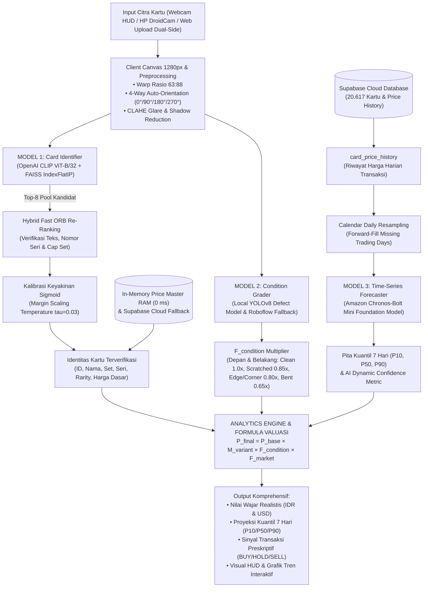

# Pokemon Card Value Analytic Tool (REGOKEMON) 🎴📊

> **Dashboard Analitika Data, Triple-Engine AI (Vision & Time-Series) & Estimasi Harga Wajar Kartu Pokémon untuk Marketplace**

[](https://www.python.org/)
[](https://pytorch.org/)
[](https://github.com/mlfoundations/open_clip)
[](https://github.com/facebookresearch/faiss)
[](https://universe.roboflow.com/group-6-major-project/card-grader)
[](https://github.com/amazon-science/chronos-forecasting)
[](https://supabase.com/)
[](https://fastapi.tiangolo.com/)
[](https://react.dev/)
[](https://github.com/features/actions)
[](https://pokemontcg.io/)

---

## 📌 Ringkasan Proyek

**Pokemon Card Value Analytic Tool (REGOKEMON)** adalah sistem analitika data dan kecerdasan buatan berbasis **Triple-Engine AI & Prescriptive Analytics** yang dirancang untuk membantu penjual maupun pembeli kartu Pokémon pada **marketplace sekunder** (seperti Tokopedia, Shopee, eBay, TCGPlayer, atau komunitas kolektor lokal).

Sistem ini memecahkan 4 masalah fundamental dalam ekosistem perdagangan kartu koleksi (TCG):
1. **Identifikasi Kartu Otomatis Skala Masif (Model 1):** Mengidentifikasi jenis kartu secara instan di antara **20.617 jenis kartu** resmi menggunakan representasi semantik visual **OpenAI CLIP (ViT-B/32)**, pencarian vektor berkecepatan tinggi **FAISS**, dan verifikasi mikro **ORB**.
2. **Penilaian Cacat Fisik Otomatis (Model 2):** Mendeteksi kerusakan fisik permukaan kartu (*scratch*, *edge wear*, *corner wear*, *bent/crease*) menggunakan **YOLOv8 Object Detection**.
3. **Peramalan Tren Deret Waktu & Sinyal Preskriptif (Model 3):** Memproyeksikan pergerakan harga 7 hari ke depan beserta pita ketidakpastian probabilistik (P10, P50, P90) dan menghasilkan sinyal trading preskriptif **BUY (Undervalued)**, **HOLD (Fair Market)**, atau **SELL (Overvalued)** menggunakan foundation model **Amazon Chronos-Bolt**.
4. **Valuasi Harga Pasar Wajar Dinamis:** Mengintegrasikan data harga historis dari Supabase Cloud dengan formula depresiasi kondisi untuk menghasilkan estimasi nilai riil yang objektif.

---

## 🤖 Arsitektur Triple-Engine AI & Analytics



---

### 1️⃣ Model 1: Card Identification Engine (CLIP ViT-B/32 + FAISS + ORB)

* **Backbone:** Vision Transformer **`openai/clip-vit-base-patch32` (`ViT-B/32`)** pra-latih pada 400 juta pasangan citra-teks.
* **Mengapa Vision Transformer (ViT), Bukan CNN Konvensional?**
  * **Global Self-Attention:** ViT membagi citra menjadi 49 patch (7 × 7 grid berukuran 32 × 32 px) dan memproses korelasi visual secara serentak. Model menghubungkan posisi teks nama, simbol energi, dan ilustrasi karakter secara menyeluruh.
  * **Open-Set Metric Learning:** Tidak menggunakan layer klasifikasi *Softmax* yang kaku (20.000 kelas). Kartu baru cukup diekstrak vektor 512-D-nya dan dimasukkan ke indeks FAISS dalam hitungan detik tanpa perlu *retraining* model.
  * **Ketahanan Optik (Robustness):** Sangat tahan terhadap pantulan cahaya (*glare*) dari pelindung plastik (*sleeve*), sudut miring, dan variasi pencahayaan ruangan.
* **Vector Indexing (FAISS IndexFlatIP):**
  * Seluruh 20.617 kartu disimpan dalam format vektor 512 float32 ternormalisasi L2 (`card_embeddings.index`, ukuran RAM hanya ~42 MB).
  * Menghitung *Cosine Similarity* secara paralel dalam waktu sub-milidetik (< 1 ms).
* **Two-Stage Re-Ranking (Fast ORB Keypoints):**
  * Kartu Pokémon memiliki kasus unik berupa **kartu reprint** (artwork karakter sama persis, tetapi beda nomor seri dan simbol set di bagian bawah).
  * Sistem menyaring kandidat teratas melalui FAISS, lalu mengekstrak fitur lokal mikro menggunakan **ORB (500 keypoints)** dengan bobot gabungan:
    ```
    Score_blended = 0.60 × Score_CLIP + 0.40 × Score_ORB
    ```
  * **Optimalisasi Pool Size 8:** Menggunakan pool top-8 untuk verifikasi mikro ORB yang terbukti mempertahankan akurasi 93,8% sekaligus menghemat latensi disk I/O >1.000 ms dibandingkan evaluasi 100 pool.
* **Kalibrasi Margin Sigmoid:**
  * Menghitung selisih margin skor ke *runner-up* kartu dengan nama berbeda (Δ), lalu diskalakan dengan temperatur τ = 0.03:
    ```
    P = 100 / (1 + exp(-Δ / τ))
    ```
  * Menghindari *overconfidence* pada varian kartu yang mirip.
* **Optimalisasi Throughput & Latensi Tinggi:**
  * **Client-Side Canvas 1280px Pre-Resizing:** Browser otomatis mengompresi foto mentah smartphone (10–15 MB) menjadi ~150–300 KB tanpa kehilangan fitur penting, memangkas waktu transfer HTTP sebesar 97%.
  * **Zero-Latency In-Memory Price Resolution (0 ms):** Mengutamakan pencarian harga dari master dataset RAM (20.617 kartu), melenyapkan jeda jaringan Supabase 300–800 ms.
  * **Background Pre-Warming:** Memuat dan memanaskan bobot CLIP dan YOLOv8 saat server FastAPI booting, melenyapkan *cold-start* bagi pengguna.
  * **Offline Mode Isolation:** Mengunci `HF_HUB_OFFLINE=1` untuk mencegah handshake remote ke server Hugging Face saat model diinisialisasi.
* **3 Varian Interface Model 1:**
  1. **`card_identifier_realtime.py` (Live Scanner HUD 30+ FPS):** Menggunakan arsitektur *Multithreaded Asynchronous Worker* (thread rendering kamera dipisah dari thread inferensi AI), *In-Memory ORB Cache*, dan *Temporal Smoothing* (buffer 7-frame konsensus). Latensi: **~83 ms di CPU** dan **~18 ms di GPU RTX 2050**.
  2. **`card_identifier_oncam.py` (Snapshot Camera):** Membuka webcam/IP Cam dengan tombol capture manual dan visualisasi target box.
  3. **`card_identifier_manual.py` (File Evaluasi Presisi):** Evaluasi foto statis melalui File Explorer atau CLI dengan Full 4-Way Auto-Orientation & Dual-View (Portrait + Square).
* **Dokumentasi Lengkap:** Pelajari arsitektur dan perbandingan performa di [`docs/clip_model_architecture_and_rationale.md`](docs/clip_model_architecture_and_rationale.md).

---

### 2️⃣ Model 2: Card Condition Grader (Local YOLOv8 & Dual-Side Defect Inspection)

* **Tujuan:** Mendeteksi, melokalisasi, dan mengukur tingkat keparahan cacat fisik kartu secara objektif untuk penentuan grade kondisi.
* **Arsitektur Model:**
  * **Local PyTorch Model (`models/best-model-v5-card-condition.pt`):** Model deteksi objek Ultralytics YOLOv8 yang telah dilatih secara lokal untuk mengenali cacat kartu dengan performa inferensi instan di RAM/GPU.
  * **Cloud Fallback:** Terintegrasi dengan endpoint Roboflow Cloud Inference API (`card-grader`) sebagai cadangan otomatis (*graceful fallback*) jika model lokal tidak aktif.
* **Dual-Side Inspection (Tampak Depan & Tampak Belakang):**
  * Mendukung inspeksi cacat pada kedua sisi kartu (`detect_card_defects_dual_side`). Cacat di sisi belakang (seperti *edge whitening* atau *corner scuff*) turut diperhitungkan dalam kalkulasi grade kondisi akhir.
* **Kelas Cacat Fisik & Pengali Depresiasi (F_condition):**
  * `Clean / Mint (Mulus)` → Multiplier = **1.00** *(Nilai penuh)*
  * `Scratched (Lecet Permukaan)` → Multiplier = **0.85** *(Penurunan 15%)*
  * `Edge Wear (Kikis Tepi)` → Multiplier = **0.80** *(Penurunan 20%)*
  * `Corner Wear (Kikis Sudut)` → Multiplier = **0.80** *(Penurunan 20%)*
  * `Bent / Crease (Tertekuk)` → Multiplier = **0.65** *(Penurunan 35%)*

---

### 3️⃣ Model 3: Industrial Time-Series Forecasting (Amazon Chronos-Bolt Mini)

* **Backbone:** Time-Series Foundation Model **`amazon/chronos-bolt-mini`** (AWS Research, 2024) berbasis arsitektur Transformer Encoder-Decoder (T5).
* **Mengapa Foundation Model Deret Waktu, Bukan Pendekatan Klasik?**
  * **Zero-Shot Pre-Trained:** Chronos-Bolt telah dipra-latih pada miliaran titik data deret waktu sintetis dan riil lintas domain industri. Model mampu mengenali tren harga dan volatilitas tanpa perlu *fine-tuning* manual per-kartu.
  * **Probabilistic Quantile Ribbons (P10, P50, P90):** Alih-alih tebakan angka tunggal (*point estimate*), Chronos-Bolt menghasilkan rentang kuantil probabilistik:
    * **P10 (Pessimistic Floor):** Batas bawah harga jika terjadi aksi jual atau koreksi likuiditas.
    * **P50 (Median Baseline):** Estimasi harga paling mungkin di masa depan.
    * **P90 (Optimistic Ceiling):** Batas atas harga jika minat beli melonjak.
  * **Kecepatan Inferensi Sub-Detik (~30 ms):** Menggunakan *direct multi-step patch prediction*, Chronos-Bolt Mini memproyeksikan seluruh cakrawala 7 hari secara serentak tanpa akumulasi eror autoregresif.
* **Pipeline Standardisasi Kalender Harian (Daily Forward-Fill Resampling):**
  * Mengisi celah hari transaksi yang kosong dengan metode *forward-fill* (`ffill`) pada frekuensi harian `D`, memastikan deret waktu teratur sebelum diproses oleh model Transformer.
* **Logika Keputusan Pasar Preskriptif (Dynamic Trading Tunnel):**
  * Membandingkan harga listing penjual saat ini terhadap rentang kuantil dinamis H+1:
    * `Listing Price < P10(H+1)` → **BUY (Undervalued)** — Peluang beli di bawah lantai harga wajar.
    * `P10(H+1) <= Listing Price <= P90(H+1)` → **HOLD (Fair Market)** — Harga berada dalam toleransi wajar pasar.
    * `Listing Price > P90(H+1)` → **SELL (Overvalued)** — Harga listing terlalu mahal di atas batas atas wajar.
* **Metrik Keyakinan AI Dinamis (Confidence Metric):**
  * Dihitung matematis dari rasio dispersi: `Spread Ratio = (P90 - P10) / P50`. Jika pita sempit, AI Confidence tinggi (~95%); jika pasar bergejolak liar, pita melebar dan confidence turun secara transparan.
* **Dokumentasi Lengkap:** Pelajari arsitektur dan justifikasi teknis di [`docs/chronos_model_architecture_and_rationale.md`](docs/chronos_model_architecture_and_rationale.md).

---

### 4️⃣ Formula Valuasi Harga Wajar Dinamis

```
P_final = P_base × M_variant × F_condition × F_market
```

* **P_base:** Harga pasar efektif konsolidasi TCGPlayer & Cardmarket dari Supabase Cloud.
* **M_variant:** Pengali kelangkaan edisi khusus (Vintage sebelum tahun 2005: +20% s/d +50%, Secret Rare/Promo: +15% s/d +35%).
* **F_condition:** Pengali kondisi fisik objektif dari Model 2 YOLOv8.
* **F_market:** Atribut kondisi penjualan (Bahasa Inggris/Jepang vs Indonesia, kelengkapan Toploader/Sleeve).

---

## ⚡ Tolak Ukur Kuantitatif & Benchmark Komputasi

| Parameter Evaluasi | Nilai Benchmark | Catatan Implementasi |
|---|:---:|---|
| **Latensi Upload Manual Web** | **~1.000 – 1.400 ms** | Integrasi penuh (Canvas 1280px + Model 1 + Model 2 YOLO + Valuasi) |
| **Ukuran Payload Foto Klien** | **150 – 300 KB** | HTML5 Canvas JPEG 0.88 (dipangkas ~97% dari 10–15 MB) |
| **Akurasi Pengenalan Kartu Riil** | **93,8%** | Uji empiris foto manual smartphone (15/16 kartu teridentifikasi tepat) |
| **Pencarian Harga Pasar (In-Memory)** | **0,00 ms** | Akses instan dari master CSV 20.617 kartu di RAM (Zero-Latency) |
| **Latensi Inferensi Model 1 (GPU RTX 2050)** | **~18 ms** | CUDA PyTorch Tensor Stream (`card_identifier_realtime.py`) |
| **Latensi Inferensi Model 1 (CPU Optimized)** | **~83 ms** | Single-View + In-Memory ORB Descriptor Caching |
| **Pencarian Indeks Vektor FAISS** | **< 1 ms** | `IndexFlatIP` untuk 20.617 kartu (~42 MB RAM) |
| **Latensi Inferensi Model 3 Chronos-Bolt (GPU)** | **~25 - 35 ms** | Peramalan kuantil 7 hari per kartu (`chronos_forecaster.py`) |
| **Latensi Inferensi Model 3 Chronos-Bolt (CPU)** | **~180 ms** | Standalone inference tanpa akselerasi CUDA |
| **Frame Rate Kamera Live** | **30+ FPS** | Stabil berkat pemisahan *Asynchronous Worker Thread* |
| **Dimensi Representasi Vektor** | **512 Dimensi** | L2-Normalized Hypersphere Embeddings (CLIP ViT-B/32) |
| **Ukuran Dataset Katalog** | **20.617 Kartu** | Database resmi pokemontcg.io (1999–2026) |
| **Cakrawala Peramalan (Horizon)** | **7 Hari (H+1 s/d H+7)** | Proyeksi multi-kuantil P10, P50, P90 |
| **Sinkronisasi Harga Harian** | **Otomatis Harian** | GitHub Actions Cron Job mengupdate harga pasar ke Supabase |

---

## 📊 Dataset & Database Cloud Supabase

| Entitas Data | Volume | Keterangan |
|---|:---:|---|
| **Katalog Kartu Bersih** | **20.617 baris** | Sinkron 1-to-1 di Supabase, CSV, dan JSON |
| **Ekspansi Rilis (Sets)** | **172 Set** | Base Set (1999) hingga ekspansi modern |
| **Gambar Terkompresi** | **20.617 JPG** | Resolusi 640×640 Lanczos di `backend/dataset/compressed_images/` |
| **Tabel Supabase Cloud** | **4 Tabel Relasional** | `sets`, `cards`, `card_prices`, `card_price_history` |
| **Cakupan Harga Efektif** | **95,48%** | 19.686 kartu memiliki data harga pasar aktif |
| **Median Harga Pasar** | **$0,96 (~Rp14.880)** | 50% kartu Pokémon bernilai <= $1 USD (*Right-Skewed*) |

> [!TIP]
> Dokumentasi teknis rinci mengenai arsitektur model, variabel data, skema SQL, dan analisis statistik:
> * 📄 [`docs/chronos_model_architecture_and_rationale.md`](docs/chronos_model_architecture_and_rationale.md) — Arsitektur & rasional ilmiah Amazon Chronos-Bolt Mini.
> * 📄 [`docs/clip_model_architecture_and_rationale.md`](docs/clip_model_architecture_and_rationale.md) — Arsitektur & rasional ilmiah CLIP ViT-B-32 + FAISS + ORB.
> * 📄 [`docs/dataset_dictionary.md`](docs/dataset_dictionary.md) — Kamus data 22 variabel CSV.
> * 📄 [`docs/dataset_summary_and_metrics.md`](docs/dataset_summary_and_metrics.md) — Ringkasan statistik & metrik eksekutif.
> * 📄 [`docs/supabase_database_dictionary.md`](docs/supabase_database_dictionary.md) — Skema database PostgreSQL Supabase.
> * 📄 [`docs/schema.sql`](docs/schema.sql) — Script DDL pembuatan tabel database.

---

## 🏗️ Struktur Repositori

```text
pokemon-card-value-analytic-tool/
├── .github/
│   └── workflows/
│       └── daily_price_cron.yml          # GitHub Actions cron pelacak harga harian otomatis
│
├── backend/                              # Backend Python, Database, & AI Engine
│   ├── app/                              # Modular REST API (FastAPI)
│   │   ├── main.py                       # Server Entrypoint (/identify, /analyze, /cards, /sets, /forecast, /dashboard)
│   │   ├── cv_service.py                 # In-Memory Bridge (Model 1 CLIP + Model 2 YOLOv8 Dual-Side)
│   │   ├── analytics_engine.py           # Formula Valuasi Harga Wajar, Chronos Forecaster, & Sinyal Pasar
│   │   ├── currency_service.py           # Layanan sinkronisasi kurs USD ke IDR dengan fallback rate
│   │   └── schemas.py                    # Skema validasi Pydantic (Request, Response, Forecast, Pricing)
│   │
│   ├── dataset/                          # Master Data & Asset Citra
│   │   ├── pokemon_cards_dataset_cleaned.csv  # Dataset Bersih (20.617 baris, 22 kolom)
│   │   ├── pokemon_cards_dataset_cleaned.json # Dataset JSON (20.617 entitas kartu)
│   │   ├── compressed_images/            # 20.617 gambar JPG 640x640 Lanczos terkompresi
│   │   └── card-condition-dataset/       # Dataset Roboflow untuk pelatihan Model 2 YOLOv8
│   │
│   ├── models/                           # Model AI & Engine Identifikasi
│   │   ├── best-model-v5-card-condition.pt # Bobot PyTorch model YOLOv8 Condition Grader lokal
│   │   ├── card_identifier.py            # Engine Utama Model 1 (CLIP + FAISS + Top-8 ORB + Sigmoid)
│   │   ├── card_identifier_realtime.py   # Live Scanner HUD 30+ FPS (Asynchronous Worker Thread)
│   │   ├── card_identifier_oncam.py      # Pemindai Snapshot Kamera Interaktif
│   │   ├── card_identifier_manual.py     # Pengujian Foto Statis (GUI File Explorer / CLI)
│   │   ├── card_condition_grader.py      # Engine Model 2 (Roboflow YOLOv8 Defect Detection fallback)
│   │   ├── chronos_forecaster.py         # Engine Model 3 (Amazon Chronos-Bolt Mini Time-Series Forecaster)
│   │   ├── build_card_index.py           # Generator Vektor Indeks FAISS resmi (CLIP ViT-B-32)
│   │   ├── calibrate_confidence.py       # Kalibrasi temperatur sigmoid margin confidence (tau=0.03)
│   │   ├── image_card_condition_test.py  # Skrip pengujian deteksi cacat pada citra kartu
│   │   ├── live_card_condition_test.py   # Skrip pengujian deteksi cacat secara on-cam
│   │   ├── card_embeddings.index         # Binary Indeks FAISS (512-dim, 20.617 kartu, ~42 MB)
│   │   ├── card_id_map.json              # Pemetaan indeks FAISS ke card_id resmi
│   │   └── legacy_mobilenet/             # [Arsip] Baseline MobileNetV3 untuk studi komparasi
│   │
│   ├── notebooks/                        # Eksplorasi Analisis Data (Jupyter Notebooks)
│   │   ├── eda_research_tcg.ipynb        # Visualisasi distribusi data & pemodelan
│   │   └── valuation_analytics.ipynb     # Analisis mendalam pasar & eksperimen valuasi
│   │
│   ├── seed_supabase.py                  # Seeding dataset bersih ke Supabase Cloud
│   ├── daily_price_tracker.py            # Sinkronisasi harga harian dari pokemontcg.io
│   ├── fetch_pokemon_data.py             # Script unduh katalog mentah dari pokemontcg.io v2 API
│   ├── clean_csv_broken_links.py         # Pembersihan tautan CDN yang mati (53 link)
│   ├── export_broken_links.py            # Export audit laporan broken links
│   ├── compress_images.py                # Kompresi paralel gambar ke format JPG Lanczos
│   ├── test_api_endpoints.py             # Uji integrasi endpoint REST API
│   ├── requirements.txt                  # Dependensi Python Backend
│   └── .env                              # Konfigurasi API Keys & CAMERA_SOURCE
│
├── frontend/                             # Single Page Application (React 18 + Vite)
│   ├── src/
│   │   ├── components/
│   │   │   ├── CatalogPage.jsx           # Katalog Interaktif 20.617 kartu (Filter, Search, Sort)
│   │   │   ├── ScannerDashboard.jsx      # Live Scanner Web UI (Webcam Feed, HUD 63:88, Ketajaman & Telemetri)
│   │   │   ├── DashboardPage.jsx         # Analitika Data Pasar, Chronos Quantile Charts & Sinyal BUY/HOLD/SELL
│   │   │   ├── UploadPage.jsx            # Upload Foto Statis (Canvas 1280px Resize, Drag-and-Drop & YOLOv8)
│   │   │   ├── HeroSection.jsx           # Banner Utama Interaktif
│   │   │   └── Navbar.jsx                # Navigasi Global
│   │   ├── App.jsx                       # Routing & State Manajer
│   │   └── main.jsx                      # Entrypoint React
│   └── package.json                      # Dependensi Node.js
│
├── docs/                                 # Dokumentasi Teknis Lengkap
│   ├── chronos_model_architecture_and_rationale.md # Arsitektur & Analisis Amazon Chronos-Bolt
│   ├── clip_model_architecture_and_rationale.md    # Arsitektur & Analisis CLIP ViT-B-32
│   ├── dataset_dictionary.md             # Kamus Data 22 Variabel CSV
│   ├── dataset_summary_and_metrics.md    # Statistik & Metrik Dataset Master
│   ├── supabase_database_dictionary.md   # Dokumentasi Database Supabase
│   └── schema.sql                        # Script DDL Relasional Database
└── README.md                             # Dokumentasi Utama Proyek
```

---

## 🚀 Panduan Menjalankan Sistem

### Persyaratan Awal:
* **Python 3.10 – 3.12** dengan virtual environment terisolasi (`pokemon_env`).
* **Node.js 18+** & npm.
* Kamera laptop atau Kamera HP melalui aplikasi **DroidCam**.

---

### 1. Menjalankan Live Scanner HUD (Real-Time 30+ FPS)

Mode ini adalah demonstrasi visual utama Model 1:
```powershell
# Jalankan dengan environment Python proyek:
& "D:\pokemon_env\Scripts\python.exe" backend/models/card_identifier_realtime.py
```
* **Kamera HP (DroidCam):** Atur variabel `CAMERA_SOURCE=http://<IP_HP>:4747/video` di `backend/.env`.
* **Webcam Laptop:** Atur `CAMERA_SOURCE=0` di `backend/.env`.
* **Shortcut Keyboard saat HUD Berjalan:**
  * `[Spasi]` : Freeze / Unfreeze frame pemindaian.
  * `[M]` : Toggle mode Fullscreen.
  * `[R]` : Rotasi orientasi tampilan (0° / 90° / 180° / 270°).
  * `[F]` : Mengirim sinyal Autofokus ke kamera HP.
  * `[Q]` : Keluar dari aplikasi.

---

### 2. Menjalankan Backend Server (FastAPI)

```powershell
cd backend
& "D:\pokemon_env\Scripts\python.exe" -m uvicorn app.main:app --reload --port 8000
```
* Server berjalan di: `http://127.0.0.1:8000`
* Dokumentasi Interaktif (Swagger UI): `http://127.0.0.1:8000/docs`
* **Endpoints Utama:**
  * `POST /identify` : Identifikasi cepat Model 1 On-Cam (Base64 citra kamera).
  * `POST /upload/identify` : Versi Multipart Form-Data untuk identifikasi Model 1.
  * `POST /analyze` : Analisis lengkap citra statis (Model 1 + Model 2 YOLOv8 depan & belakang + Valuasi harga wajar).
  * `POST /upload/analyze` : Versi Multipart Form-Data untuk analisis lengkap.
  * `GET  /cards` : Katalog kartu Pokémon (mendukung parameter `search`, `supertype`, `rarity`, `set_id`, `sort_by`, `page`, `limit`).
  * `GET  /sets` : Daftar seluruh set kartu untuk filter dropdown.
  * `GET  /cards/{card_id}/history` : Riwayat tren harga harian untuk grafik pasar.
  * `GET  /cards/{card_id}/forecast` : Proyeksi harga kuantil 7 hari (P10, P50, P90) dan sinyal preskriptif via Amazon Chronos-Bolt.
  * `POST /cards/{card_id}/condition` : Deteksi cacat fisik kartu mandiri via YOLOv8 (Base64).
  * `POST /upload/cards/{card_id}/condition` : Deteksi cacat fisik kartu mandiri via Multipart Form-Data.
  * `GET  /dashboard` : Statistik agregat pasar, pergerakan tren, dan kartu terpopuler.
  * `GET  /currency` : Status kurs live USD ke IDR dan waktu pembaruan terakhir.
  * `GET  /health` : Healthcheck status server.

---

### 3. Menjalankan Frontend Web Portal (React + Vite)

Buka terminal baru:
```powershell
cd frontend
npm install
npm run dev
```
Buka browser di: **`http://localhost:5173`**
* **Navigasi Halaman:**
  * **CATALOG (`#catalog`):** Eksplorasi 20.617 kartu lengkap dengan foto, nama, nomor set, kelangkaan, dan harga pasar wajar (IDR & USD).
  * **LIVE SCANNER HUD:** Pindai kartu secara langsung melalui webcam browser dengan antarmuka Cyber Obsidian HUD (viewfinder 63:88, indikator ketajaman sensor Laplacian, laser animasi, serta telemetri FPS & latensi).
  * **DASHBOARD (`#dashboard`):** Visualisasi analitika pasar, grafik harga historis, proyeksi kuantil dinamis 7 hari Amazon Chronos-Bolt (P10, P50, P90), dan rekomendasi preskriptif (BUY/HOLD/SELL).
  * **UPLOAD / INSPECT:** Unggah berkas foto kartu (dengan kompresi otomatis Canvas 1280px & drag-and-drop) untuk inspeksi cacat fisik komprehensif depan & belakang via YOLOv8.

---

### 4. Pengujian Model & Skrip Tambahan

* **Uji Peramalan Amazon Chronos-Bolt:**
  ```powershell
  & "D:\pokemon_env\Scripts\python.exe" backend/models/chronos_forecaster.py
  ```
* **Uji Foto Manual (GUI File Explorer):**
  ```powershell
  & "D:\pokemon_env\Scripts\python.exe" backend/models/card_identifier_manual.py
  ```
* **Membangun Ulang Indeks Vektor FAISS:**
  ```powershell
  & "D:\pokemon_env\Scripts\python.exe" backend/models/build_card_index.py
  ```
* **Jalankan Pelacak Harga Harian:**
  ```powershell
  & "D:\pokemon_env\Scripts\python.exe" backend/daily_price_tracker.py
  ```

---

## 📜 Lisensi & Atribusi

* **Metadata Kartu & Harga Pasar:** [pokemontcg.io REST API](https://pokemontcg.io/)
* **Vision Transformer Backbone (Model 1):** [OpenAI CLIP (OpenCLIP)](https://github.com/mlfoundations/open_clip)
* **Dataset Cacat Fisik (Model 2):** [Roboflow Universe — Card Grader](https://universe.roboflow.com/group-6-major-project/card-grader)
* **Dataset Referensi Tambahan (Model 2):** [GemSnipe Pokemon Centering Measurements](https://gemsnipe.com/) (Open-Source CC BY 4.0 via Contributor Issue #1)
* **Time-Series Foundation Model (Model 3):** [Amazon Chronos-Bolt (AWS Research)](https://github.com/amazon-science/chronos-forecasting)
* **Vector Retrieval Engine:** [Meta AI FAISS](https://github.com/facebookresearch/faiss)
* **Cloud Database:** [Supabase PostgreSQL](https://supabase.com/)
