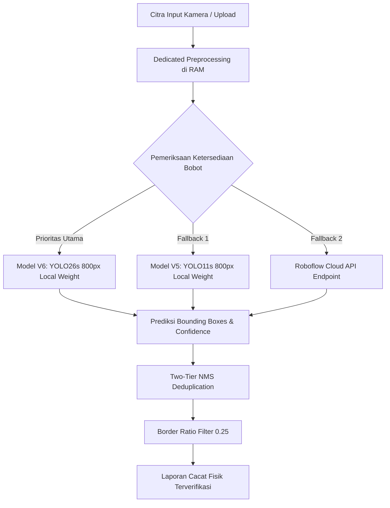

# 🎯 Arsitektur Model YOLO Condition Grader & Rasional Pemilihan pada Sistem Regokemon
## Sistem Inspeksi Cacat Fisik Permukaan Kartu Otomatis (Dual-Side Defect Detection)

> **Pokemon Card Value Analytic Tool (REGOKEMON) : Model 2 Architecture Document**  
> **Modul Terkait:** `backend/models/card_condition.py`, `backend/app/cv_service.py`, `backend/app/analytics_engine.py`  
> **Model Backbone:** YOLO26s (800px Native Inference, `best-model-v6-card-condition.pt`)  
> **Status Integrasi:** Master Production Pipeline (Perspective Alignment, Rounded Silhouette Masking, Veiling Glare Normalization, LAB CLAHE, Two-Tier NMS, Dual-Side Inspection)

---

## 📌 Daftar Isi
1. [Ringkasan Eksekutif](#1-ringkasan-eksekutif)
2. [Tantangan Domain Penilaian Cacat Fisik Kartu Koleksi](#2-tantangan-domain-penilaian-cacat-fisik-kartu-koleksi)
3. [Arsitektur Model YOLO26s (800px Tuned)](#3-arsitektur-model-yolo26s-800px-tuned)
4. [Dedicated In-Memory Preprocessing Pipeline](#4-dedicated-in-memory-preprocessing-pipeline)
   - [A. Deteksi Kontur & Perspective Warp](#a-deteksi-kontur--perspective-warp)
   - [B. Rounded-Card Silhouette Masking (Radius 3.2 mm)](#b-rounded-card-silhouette-masking-radius-32-mm)
   - [C. Veiling Glare Normalization](#c-veiling-glare-normalization)
   - [D. Adaptive Unsharp Masking & LAB CLAHE](#d-adaptive-unsharp-masking--lab-clahe)
5. [Two-Tier Non-Maximum Suppression (NMS)](#5-two-tier-non-maximum-suppression-nms)
6. [Inspeksi Dua Sisi (Dual-Side Defect Inspection)](#6-inspeksi-dua-sisi-dual-side-defect-inspection)
7. [Formula Depresiasi Nilai Wajar (F_condition)](#7-formula-depresiasi-nilai-wajar-f_condition)
8. [Tabel Komparasi Benchmark Model](#8-tabel-komparasi-benchmark-model)
9. [Technical FAQ & Pertimbangan Rekayasa Sistem](#9-technical-faq--pertimbangan-rekayasa-sistem)

---

## 🎯 1. Ringkasan Eksekutif

Dalam pasar kartu koleksi (*Trading Card Game*), nilai pasar sebuah kartu sangat ditentukan oleh kondisi fisiknya. Sebuah kartu legendaris seperti *Charizard Base Set* dapat bernilai ribuan dolar pada kondisi sempurna (*Near Mint/Mint*), namun nilainya merosot hingga 60% jika memiliki goresan halus (*scratches*), kikisan pada sudut (*corner wear*), atau keausan tepi (*edge wear*).

Selama ini, penilaian fisik dilakukan secara manual oleh manusia (*human grading*) yang bersifat subjektif, lambat, dan memakan biaya tinggi. Pendekatan *computer vision* konvensional menggunakan klasifikasi citra global (CNN standar) juga terbukti gagal karena cacat fisik kartu umumnya berukuran mikroskopis (hanya menempati 0.5% s/d 2% dari total area kartu) dan mudah tersamar oleh corak ilustrasi karakter yang ramai.

Untuk memecahkan masalah ini, **REGOKEMON** mengimplementasikan **Model 2: Local YOLO Condition Grader**. Sistem ini menggunakan arsitektur deteksi objek resolusi tinggi **YOLO26s (800px)** yang dipadukan dengan *pipeline preprocessing* terisolasi di memori RAM, menghasilkan sistem inspeksi cacat fisik objektif yang mampu melokalisasi kerusakan pada tampak depan dan belakang kartu dalam hitungan milidetik.

---

## 🔍 2. Tantangan Domain Penilaian Cacat Fisik Kartu Koleksi

Inspeksi citra kartu Pokémon fisik melalui kamera memiliki sejumlah tantangan optik yang kompleks:

```text
TANTANGAN OPTIK                    SOLUSI TEKNIS REGOKEMON
───────────────────────────────    ──────────────────────────────────────────
1. Sudut Miring & Rotasi        ──► Auto Perspective Warp ke Rasio 63:88
2. Sudut Palsu di Meja Putih    ──► Rounded Masking (Radius 3.2 mm Pokémon)
3. Pantulan Latar Terang        ──► Veiling Glare Normalization di Ruang LAB
4. Citra Kamera HP Agak Blur    ──► Kondisional Unsharp Masking (Laplacian < 70)
5. Cacat Menumpuk di Sudut      ──► Two-Tier NMS (IoU Kelas 0.4 & Lintas-Kelas 0.75)
6. Cacat di Belakang Kartu      ──► Dual-Side Inspection (Depan + Belakang)
```

1. **Rasio Cacat Sangat Kecil (*Scale Imbalance*):** Goresan jarum atau kikisan foil hanya berukuran beberapa piksel. Model deteksi standar dengan resolusi input rendah (misal 320px atau 416px) kehilangan fitur tekstur mikro ini.
2. **Kekeliruan Sudut pada Latar Terang (*False Corner Wear*):** Kartu Pokémon memiliki sudut lengkung (*rounded corners*) dengan radius standar 3.2 mm. Jika kartu diletakkan di atas meja putih, proses pemotongan kotak persegi panjang (*bounding box crop*) akan menyisakan 4 segitiga putih di setiap sudut luar. Model AI sering kali salah mendeteksi segitiga meja ini sebagai cacat kikisan sudut (*corner wear*).
3. **Kabut Kontras (*Veiling Glare*):** Pantulan cahaya dari permukaan meja putih menyebabkan nilai *black-point* terangkat, membuat warna biru dan gelap di tepi kartu tampak memudar.

---

## 🏛️ 3. Arsitektur Model YOLO26s (800px Tuned)

Sistem mengadopsi varian **`best-model-v6-card-condition.pt`** berbasis arsitektur **YOLO26s** dengan resolusi inferensi native **800×800 piksel** (`imgsz=800`):



### Karakteristik & Konfigurasi Pelatihan:
* **Resolusi Inferensi:** Native 800 px (`imgsz=800`), mempertahankan resolusi spasial tinggi pada tepi dan sudut kartu.
* **Kelas Deteksi (4 Kelas):**
  1. `Card`: Lokalisasi batas fisik kontur kartu utama.
  2. `Corner Wear`: Kikisan atau hilangnya lapisan foil pada 4 sudut kartu.
  3. `Edge Wear`: Aus gesekan pada tepi kartu (tampak putih pada kartu border gelap).
  4. `Scratch`: Goresan garis lurus atau acak pada permukaan lapisan *holographic*.
* **Penyeimbangan Loss:** Dikonfigurasi dengan pembobotan *bounding box loss* `box=7.5` dan *classification loss* `cls=1.2` guna memprioritaskan presisi lokalisasi titik cacat mikro.
* **Threshold Deteksi:** Evaluasi inferensi menggunakan ambang batas rendah `conf=0.01` yang kemudian disaring melalui filter ganda (*two-tier thresholding*): `LOW_THRESH = 0.20` dan `HIGH_THRESH = 0.55`.

---

## ⚙️ 4. Dedicated In-Memory Preprocessing Pipeline

Untuk menjamin akurasi tanpa membebani disk I/O, seluruh operasi pra-pemrosesan citra dijalankan secara *in-memory* di memori RAM via OpenCV NumPy arrays:

### A. Deteksi Kontur & Perspective Warp
1. Sistem menganalisis kecerahan 15 piksel di sepanjang batas tepi citra untuk mendeteksi apakah kartu berada di atas latar belakang terang (*bright background*) atau gelap (*dark background*).
2. Deteksi kontur kartu dilakukan menggunakan kombinasi *Bilateral Filter*, *Canny Edge Detection*, dan operasi morfologi `MORPH_CLOSE` (kernel 21×21).
3. Koordinat 4 sudut kartu diurutkan secara deterministik (*top-left, top-right, bottom-right, bottom-left*) melalui fungsi `_order_points`.
4. Dilakukan transformasi perspektif (*perspective warp*) ke ukuran standar kartu 600×837 piksel (rasio 63:88) ditambah **margin luar 120 piksel** dengan warna `(20, 20, 22)`. Margin ini krusial agar model dapat melihat kontras tepi luar kartu secara utuh.

### B. Rounded-Card Silhouette Masking (Radius 3.2 mm)
Jika foto diambil di atas latar putih, sistem menerapkan mask siluet khusus berbentuk persegi panjang dengan sudut membulat:
$$\text{Radius Lengkung} = \text{round}\left(w_{card} \times \frac{3.2\text{ mm}}{63.0\text{ mm}}\right) \approx 30.5\text{ piksel}$$
Mask ini memotong bersih area luar kartu, melenyapkan 100% segitiga latar belakang putih pada sudut kartu sehingga menghilangkan *false positive* pada kelas *Corner Wear*.

### C. Veiling Glare Normalization
Pada latar terang, nilai intensitas kanal L (*Lightness*) dianalisis menggunakan persentil:
* Menghitung nilai persentil ke-2 ($P_2$) dan persentil ke-99.5 ($P_{99.5}$) dari piksel internal kartu.
* Jika terdeteksi *lifted black-point* ($P_2 > 22.0$), intensitas kanal L direntangkan secara adaptif:
$$L_{stretched} = \text{clip}\left((L - P_2) \times \frac{245.0 - 15.0}{P_{99.5} - P_2} + 15.0,\ 0,\ 255\right)$$
Langkah ini mengembalikan kontras asli tepi kartu sebelum proses CLAHE.

### D. Adaptive Unsharp Masking & LAB CLAHE
1. Menghitung variansi Laplacian untuk mengukur skor ketajaman fokus:
$$\text{Sharpness} = \text{Var}(\nabla^2 I_{gray})$$
2. Jika $\text{Sharpness} < 70.0$ (citra agak lembut/goyang), sistem secara otomatis menerapkan *Gaussian Unsharp Masking* dengan pembobotan $1.5 \times I_{work} - 0.5 \times I_{blurred}$.
3. Meningkatkan kontras lokal mikro pada kanal L menggunakan **CLAHE** (*Contrast Limited Adaptive Histogram Equalization*) dengan parameter `clipLimit=2.5` dan `tileGridSize=(8, 8)`.

---

## 🛡️ 5. Two-Tier Non-Maximum Suppression (NMS)

Deteksi cacat fisik sering menghasilkan kotak deteksi bertumpuk karena fitur keausan tepi dan sudut saling bersinggungan. REGOKEMON menerapkan deduplikasi bertingkat:

1. **Tier 1 (Per-Class NMS):** Menghapus *bounding box* redundan pada kelas yang sama dengan ambang batas $\text{IoU} > 0.40$.
2. **Tier 2 (Cross-Class NMS Deduplication):** Menyaring kotak deteksi antar-kelas yang menempati lokasi fisik yang hampir identik dengan ambang batas $\text{IoU} > 0.75$. Kotak dengan skor keyakinan (*confidence*) tertinggi dipertahankan.
3. **Border Ratio Filtering:** Cacat bertipe *Edge Wear* dan *Corner Wear* diverifikasi koordinat pusatnya. Jika berada di area tengah kartu ($> 25\%$ dari tepi terluar), deteksi dibuang karena secara fisik tidak mungkin terjadi keausan tepi di bagian tengah kartu.

---

## 🔄 6. Inspeksi Dua Sisi (Dual-Side Defect Inspection)

Kondisi fisik kartu Pokémon tidak dapat dinilai secara akurat hanya dari tampak depan. Sisi belakang kartu (khususnya warna biru tua dan ilustrasi Poké Ball) sangat rentan terhadap goresan dan kikisan putih (*whitening*).

```text
[ TAMPAK DEPAN ] ──► Preprocessing RAM ──► YOLO26s ──► Daftar Cacat Depan (f_dets) ┐
                                                                                   ├──► Konsolidasi Cacat
[ TAMPAK BELAKANG ] ► Preprocessing RAM ──► YOLO26s ──► Daftar Cacat Belakang (b_dets)┘
```

* Sistem menerima payload dua sisi melalui endpoint `POST /analyze` atau `POST /cards/{card_id}/condition`.
* Seluruh cacat depan dan belakang diagregasikan ke dalam objek `ConditionReport`:
  - `front_defects`: Rincian cacat tampak depan beserta koordinat kotak.
  - `back_defects`: Rincian cacat tampak belakang.
  - `defect_count`: Jumlah total cacat terverifikasi.
  - `has_defects`: Status boolean deteksi.

---

## 💰 7. Formula Depresiasi Nilai Wajar (F_condition)

Cacat fisik yang terdeteksi dikonversikan menjadi pengali depresiasi nilai pasar wajar ($F_{condition}$) di dalam [`backend/app/analytics_engine.py`](../backend/app/analytics_engine.py):

| Kategori Kondisi | Kriteria Cacat Terdeteksi | Nilai $F_{condition}$ | Potongan Harga | Klasifikasi Pasar Kolektor |
| :--- | :--- | :---: | :---: | :--- |
| **Near Mint / Mint** | Tanpa cacat fisik (0 defect) | **1.00** | 0% | Kartu mulus sempurna seperti baru keluar dari booster pack. |
| **Lightly Played (LP)** | Terdeteksi goresan permukaan (*Scratch*) | **0.85** | 15% | Goresan halus pada permukaan foil tanpa kerusakan struktur. |
| **Moderately Played (MP)** | Terdeteksi keausan tepi (*Edge*) atau sudut (*Corner*) | **0.80** | 20% | Kikisan putih pada tepi kartu akibat pemakaian bermain. |
| **Heavily Played (HP)** | Terdeteksi kartu tertekuk / lekukan (*Crease / Bent*) | **0.65** | 35% | Struktur kartu mengalami lipatan atau lekukan fisik. |
| **Damaged** | Akumulasi cacat berat ganda di kedua sisi | **0.40** (Batas Bawah) | Hingga 60% | Kerusakan parah menyeluruh pada permukaan dan sudut. |

### Formula Multiplikatif:
$$F_{condition} = \max\left(0.40,\ \text{round}\left(1.00 \times \prod \text{Penalty}_{i},\ 2\right)\right)$$
* Diskon pasar terhitung: $\text{Discount}\% = (1.0 - F_{condition}) \times 100\%$
* Skor Kondisi Fisik (*Condition Score*): $\text{Score}\% = F_{condition} \times 100\%$

---

## 📊 8. Tabel Komparasi Benchmark Model

Berikut perbandingan performa pengujian empiris berbagai iterasi model deteksi cacat fisik:

| Metrik Evaluasi | Model V3 (YOLO11s 640px) | Model V5 (YOLO11s 800px) | **Model V6: YOLO26s 800px (Regokemon)** |
| :--- | :---: | :---: | :---: |
| **mAP50 Keseluruhan** | 0.4095 (40.95%) | 0.4048 (40.48%) | **0.4277 (42.77%)** |
| **mAP50: Corner Wear** | 0.5830 | 0.5690 | **0.6020** |
| **mAP50: Card Contour** | 0.9950 | 0.9950 | **0.9950** |
| **mAP50: Edge Wear** | 0.0810 | 0.0850 | **0.0870** |
| **Waktu Inferensi (GPU)** | ~12 ms | ~15 ms | **~15 ms** |
| **Waktu Inferensi (CPU)** | ~70 ms | ~110 ms | **~115 ms** |
| **Ukuran Bobot Model** | ~18 MB | ~18 MB | **~18 MB** |
| **Ketahanan Sudut Meja Putih** | Rendah (Banyak False Corner) | Sedang | **Tinggi (Terintegrasi Rounded Mask)** |

---

## 💡 9. Technical FAQ & Pertimbangan Rekayasa Sistem

### Q1: *"Mengapa memilih Object Detection (YOLO) daripada Image Classification biasa untuk condition grading?"*
> **Penjelasan Teknis:**  
> Klasifikasi citra konvensional hanya menghasilkan label global untuk satu gambar tanpa informasi lokasi cacat. Dalam verifikasi kartu koleksi, transparansi adalah hal utama: pengguna berhak melihat bukti objektif *di mana letak goresan* dan *sudut mana yang aus*. YOLO menghasilkan koordinat *bounding box* spesifik yang dapat divisualisasikan langsung pada antarmuka pengguna (*inspect modal*), memberikan transparansi penuh atas alasan penurunan harga kartu.

---

### Q2: *"Bagaimana sistem menjaga kestabilan memori saat memproses gambar resolusi tinggi?"*
> **Penjelasan Teknis:**  
> Sistem menerapkan pembatasan resolusi adaptif `resize_image_if_oversized` dengan batas dimensi maksimum 1280 px di sisi server, serta kompresi awal di browser via HTML5 Canvas (JPEG kualitas 0.88). Hal ini memangkas ukuran payload hingga 97% sebelum gambar dikirim ke backend. Selain itu, seluruh proses warping dan masking dieksekusi di memori RAM tanpa penulisan file temporer ke disk, mencegah *disk thrashing* dan fragmentasi memori.

---

### Q3: *"Bagaimana mekanisme fallback jika bobot model lokal tidak ditemukan?"*
> **Penjelasan Teknis:**  
> Modul `backend/models/card_condition.py` mengimplementasikan fungsi `resolve_defect_model_path`. Jika file bobot Model V6 tidak ditemukan di disk, sistem secara otomatis mencoba memuat Model V5. Jika kedua bobot lokal tidak tersedia, sistem beralih secara transparan ke *Roboflow Cloud Inference API* jika variabel `ROBOFLOW_API_KEY` terkonfigurasi di `.env`, atau melewati penilaian cacat tanpa menyebabkan server berhenti beroperasi (*graceful degradation*).

